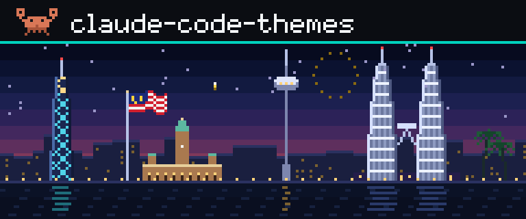

<p align="center">
  
</p>

# claude-code-themes

Looks for the Claude desktop and mobile apps. A look is a color theme with a moving pixel-art backdrop, and it can also color the headings, quotes and inline code in the chat.

This repo holds seven looks of Malaysia: **Petronas KL**, **Penang**, **Terengganu** (a light look), **Sepang F1**, **Kelantan**, **Kelantan Day** (a light look) and **Sabah**. The plugin is called `looks-malaysia`.

> **Where looks show.** Looks draw in the Claude desktop and mobile apps only. The terminal and the editor extensions do not draw them.

> **Unofficial.** This is fan art made for fun. It is not made, endorsed or sponsored by PETRONAS, Sepang International Circuit, Formula 1, or Anthropic. The scenes are simple drawings made from memory. They use no logos, and they are not to scale. The wayang kulit puppets are simple shapes made for this repo, not copies of real puppets.

## Looks

| # | Name | What you see |
| --- | --- | --- |
| 1 | `petronas-kl` | Dark. Kuala Lumpur at dusk: the Petronas Twin Towers, Merdeka 118, KL Tower, the Sultan Abdul Samad Building, the Jalur Gemilang, a lake fountain and fireworks. |
| 2 | `penang` | Dark. George Town at dusk: Komtar, the Penang Bridge, Penang Hill with the Kek Lok Si pagoda, shophouses, the Clan Jetty, red lanterns and the ferry. |
| 3 | `terengganu` | **Light.** The east coast by day: the Crystal Mosque, the Floating Mosque, a fishing boat, palms, a wau kite and a leatherback turtle. |
| 4 | `sepang` | Dark. Sepang International Circuit at dusk: the tulip-roofed grandstand, the start gantry with its five lights, the control tower, the Petronas Towers on the horizon and F1 cars on the track, under a storm. |
| 5 | `kelantan` | Dark. A Kelantan village at night: a wooden stage under a carved roof with a lit wayang kulit screen (the tree of life, Seri Rama and Hanuman, the clowns Pak Dogol and Wak Long) and musicians with a gong and a drum, a Kelantan Malay house on stilts, coconut palms, a wau bulan kite under a crescent moon, a spinning gasing top, and fireflies over the paddy fields. |
| 6 | `kelantan-day` | **Light.** The same Kelantan village by day: the wayang kulit stage with its pale cloth screen and puppets, the house on stilts, palms, the sun, birds, a wau bulan kite and a spinning gasing over bright green paddy fields and blue hills. |
| 7 | `sabah` | Dark. Sabah at sunset: Mount Kinabalu with its granite peaks lit rose and gold, a belt of cloud and rainforest at its foot, a Bajau stilt village on the water with lit windows and lanterns, a lepa boat with a tall striped sail, low islands, the setting sun and swiftlets over a sea of rose and gold. |















These pictures move. Each one is an animated SVG made from the same code as the look in the app, and it shows the scene alone, without the chat on top. Flags wave, fireworks go off, lanterns sway, water glints, and at Sepang two cars run along the track while the start lights come on one by one and the lightning flashes. At Kelantan the lamp behind the screen flickers, and the shadow play changes every three seconds between the tree of life, Rama and Hanuman, and the two clowns; the kite's tail waves, the top spins and the fireflies blink. At Kelantan Day the sun shimmers and the birds flap. At Sabah the sun shimmers, the boat rocks, the lanterns sway, the hut lamps on the mountain blink and the birds flap. If your system asks for reduced motion, the pictures stand still.

## Install

You need a Claude app that supports plugins.

1. Add this repo as a marketplace. Run this in a shell:

   ```bash
   claude plugin marketplace add aimanamri/claude-code-themes
   ```

2. Install the plugin:

   ```bash
   claude plugin install looks-malaysia@looks-malaysia
   ```

3. Reload. Run `/reload-plugins` in a Claude Code session, or start a new session.
4. Pick a look: `/look petronas-kl`.

In the desktop app, where `/plugin` does not run: click **+** next to the prompt box, then **Plugins**, then **Add marketplace**, and enter `aimanamri/claude-code-themes`. Then add the plugin `looks-malaysia`.

To get a new version:

```bash
claude plugin marketplace update looks-malaysia
claude plugin update looks-malaysia@looks-malaysia
```

Then run `/reload-plugins`.

## Switch looks

| Command | What it does |
| --- | --- |
| `/look` | Lists every look, numbered. The one in use has a filled dot. |
| `/look sepang` or `/look 4` | Switches by name or by number. |
| `/look next` | Goes to the next look, then to off, then to the first. |
| `/look off` | Returns to the app's own theme. |

The look you pick is saved in `~/.claude/looks-malaysia.json`. Every chat follows it, and new chats start with it. Until you pick one, the first look is used.

## Chat colors

A theme holds only color scales, so it cannot color markdown by itself. This plugin adds hooks that draw some parts of a message in colors of their own. They run for Claude's replies and for your own prompts (typed in the app, typed in a terminal or sent from a phone). Task notifications, peer messages and scheduled prompts are left to the app.

| Part of a message | `petronas-kl` | `penang` | `terengganu` (light) | `sepang` | `kelantan` | `kelantan-day` (light) | `sabah` |
| --- | --- | --- | --- | --- | --- | --- | --- |
| Heading (`#`, `##`, `###`) | Bold, flag yellow `#f2c230`. | Bold, lantern orange `#ff9e4a`. | Bold, songket maroon `#a8323f`. | Bold, teal `#00d2be`. | Bold, rose red `#ff8a9a`. | Bold, deep jade `#0b6a4c`. | Bold, rainforest green `#5fe0a8`. |
| Quote (`>`) | Pale teal italic `#8fe3d8`, teal frame `#2ed3c6`, dark blue `#0e2230`. | Pale peach italic `#ffd9b0`, orange frame `#ff9e4a`, dark brown `#2a1a10`. | Dark brown italic `#5a3d10`, gold frame `#c8962a`, cream `#fbf0d8`. | Pale pink italic `#ffd6d6`, red frame `#ff3b3b`, dark red `#2a1214`. | Pale cream italic `#fde8c4`, red frame `#c8402f`, dark brown `#2a1410`. | Dark brown italic `#4a2a14`, red frame `#c8402f`, cream `#fdf1dc`. | Pale lavender italic `#dcd4ff`, violet frame `#8f7aff`, deep indigo `#15122a`. |
| Inline code | Gold `#ffd45e` on dark gold `#2b2310`, mono. | Teal `#7ee0d0` on dark teal `#0e2a2c`, mono. | Deep teal `#0b6a70` on pale teal `#d3eef0`, mono. | Yellow `#ffd24a` on dark olive `#2e2808`, mono. | Jade `#7fe3b8` on dark green `#0e2a22`, mono. | Rose `#8a2a3a` on pale pink `#fbe0e4`, mono. | Sunset rose `#ffa8c0` on dark plum `#2a1220`, mono. |

The app keeps drawing everything else, as before. A paragraph or a list is drawn by the hook only if it has inline code. A block with a link, a URL, a table, a rule, HTML or a code fence stays with the app, so links stay clickable and tables keep their layout. Inline code in those blocks keeps the app's own gray.

To change a color, edit `CHAT_COLORS` in [`hooks/chat-colors.ts`](hooks/chat-colors.ts).

### Limits

- A reply the hook draws may lose the small bullet at its start. This is not confirmed on screen.
- A prompt the hook draws sits in a rounded bubble on the right, as the app draws it. The bubble is made by the hook, so its spacing may differ a little from the app's own bubble.
- Inside a heading or a quote, links keep their words but lose their address.
- Replies already on screen keep their old colors. New replies use the new ones.
- Only the colors of `petronas-kl` were checked in the real app. The others are checked in tests.

## Add a look

1. Copy `hooks/looks/penang.ts` (dark) or `hooks/looks/terengganu.ts` (light) to `hooks/looks/<id>.ts`. The `<id>` uses lowercase letters, digits and hyphens.
2. Change the colors, the scene and the exported `LookSpec`: `id`, `label`, `description` and the scene name.
3. List it in `hooks/looks/index.ts`.
4. Give it chat colors: add an entry to `CHAT_COLORS` in `hooks/chat-colors.ts`, and to the test that lists them.
5. Render it and look at it:

   ```bash
   node tools/render-look.mjs <id> out
   ```

   Open `out/preview-<id>.html` in a browser, in a wide window and in a narrow one.
6. Check the plugin:

   ```bash
   claude plugin validate .
   claude plugin test .
   ```

7. Run `/reload-plugins`, then `/look <id>`.

A scene is an SVG under 131,072 characters. The drawing helpers are in [`hooks/kit/`](hooks/kit): a pixel canvas (`Art`), sky bands, the veil behind the chat text, landmark placement for every window shape (`layout`, `view`), and shared pieces such as stars, fireworks, reflections, lit windows and water. [`AGENT.md`](AGENT.md) has the details.

## Banner art

The banner at the top is made with [Pixelbolt](https://github.com/skulitom/Pixelbolt), a local pixel-art tool that turns a JSON recipe into exact pixels. It needs Node 20 or later. [`art/make_banner_recipe.py`](art/make_banner_recipe.py) writes the recipe:

```bash
python3 art/make_banner_recipe.py recipe.json
```

```bash
node <path-to-pixelbolt>/bin/pixelbolt.js render recipe.json --out out --gif --gif-scale 4
```

The GIF is `out/gifs/main.gif`. It has 6 frames and is 768 by 320 pixels. Copy it to `assets/banner.gif`. The crab in the title bar is a small pixel drawing made for this repo. It is not the official Claude mark or mascot.

## Known issues

- **The backdrop may not move.** In app version 5.11492.5 no look animated on the author's machine, with Low Power Mode and Reduce Motion off. The scenes animate in a normal browser, so the cause may be in the app.

## Layout

| Path | What it holds |
| --- | --- |
| `hooks/looks/` | One file for each look, and `index.ts`, the list. |
| `hooks/kit/` | The drawing toolkit: `art.ts` (canvas), `layout.ts` (sky, veil, placement), `fx.ts` (shared pieces and motion CSS). |
| `hooks/register.tsx` | The plugin: `/look`, the backdrop and the chat colors hooks. |
| `hooks/chat-colors.ts`, `hooks/chat-view.tsx` | The chat colors, and how a message is split and drawn. |
| `hooks/make-colors.js`, `hooks/make-colors.d.ts` | Builds a theme from a few colors. Copied unchanged from Claude Code (see below). |
| `tests/` | Tests for `/look`, the toolkit and the chat colors. |
| `tools/render-look.mjs` | Renders a look to SVG and an HTML page, and checks its size. |
| `tools/make-preview.mjs` | Writes the page that becomes `assets/preview.png`, the 16:9 picture of all looks. |
| `assets/`, `art/` | The banner GIF, the 16:9 preview picture, and the script that makes the banner recipe. |
| `AGENT.md` | A guide for AI agents: setup, rules and recipes. |

## Credits and licence

- The code and the drawings in this repo are written by [aimanamri](https://github.com/aimanamri) and are under the MIT licence (see [`LICENSE`](LICENSE)). They are written from scratch.
- The idea of pixel-art looks for the Claude apps comes from the `looks` plugin by [markimoo09](https://github.com/markimoo09/claude-code-themes). This repo shares no code with it.
- `hooks/make-colors.js` and `hooks/make-colors.d.ts` come from the plugin-authoring guide of Claude Code, which tells mod authors to copy them into a mod and leave them as they are. They are not covered by this repo's licence.
- The banner is made with Pixelbolt, which has an MIT licence.
